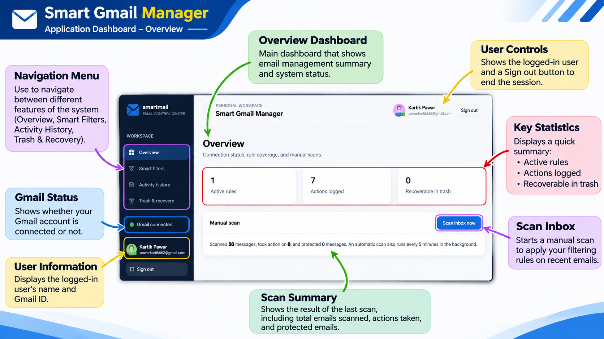
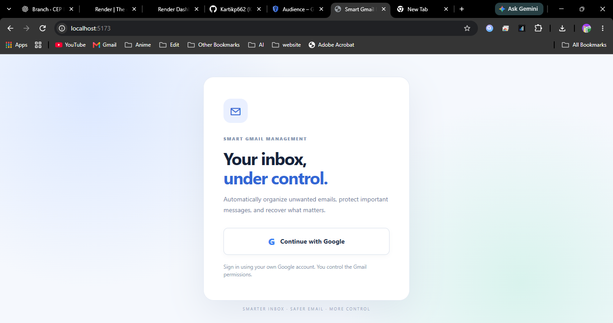
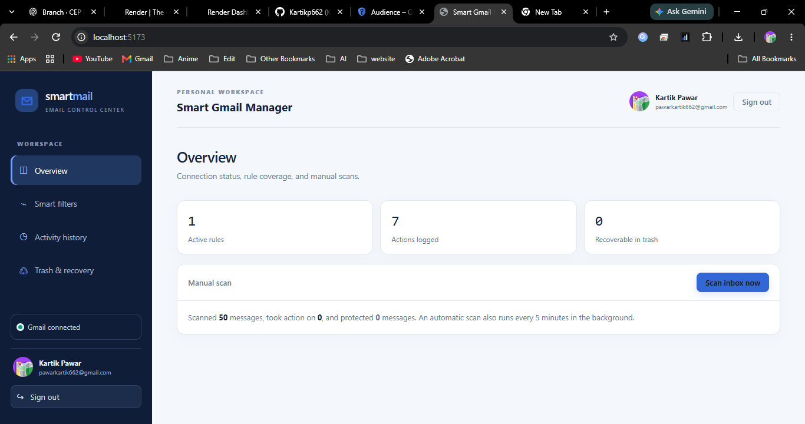
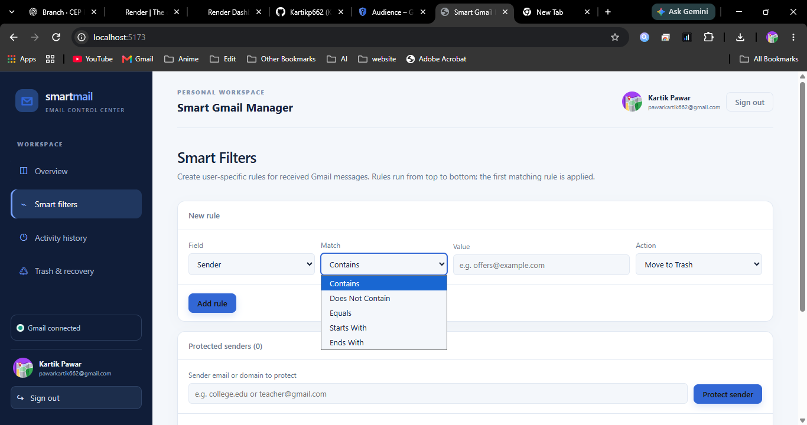
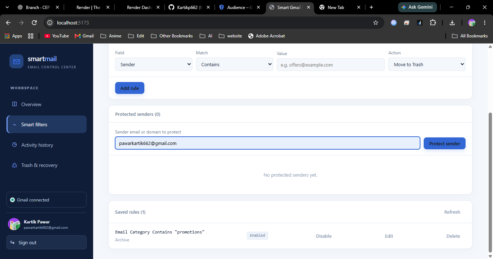
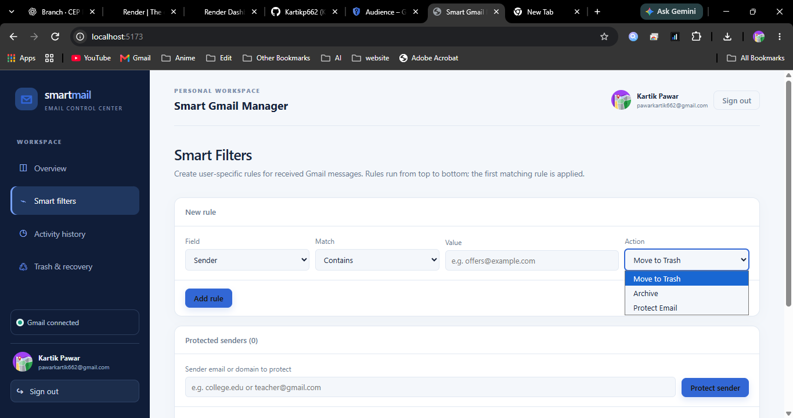
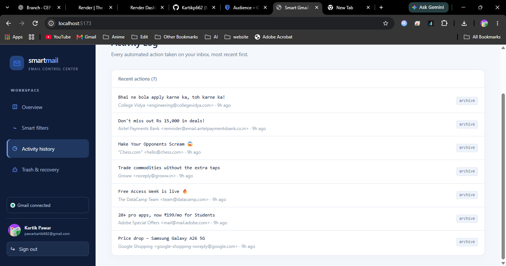

# 📧 Smart Gmail Manager
### Smart Gmail Email Management System with Automatic Filtering and Safe Trash Recovery

A web-based Gmail management application designed to simplify email organization through automatic filtering, important email protection, and safe Trash recovery.

The system uses Google OAuth 2.0 for authorization and Gmail API to perform supported email operations.

---

## 🚀 Project Overview

Managing a large number of emails manually can be time-consuming. Promotional messages, newsletters, notifications and other unwanted emails can make it difficult to find important information.

**Smart Gmail Manager** aims to solve this problem by allowing users to create custom filtering rules, organize emails automatically, protect important messages and restore emails from Trash when they are recoverable.

## ✨ Key Features

- 🔐 **Google Authentication:** Connect Gmail using Google OAuth 2.0.
- 📩 **Automatic Email Filtering:** Apply user-defined rules to email fields.
- ⚙️ **Custom Filter Rules:** Configure conditions such as Contains, Equals, Starts With and Ends With.
- 🛡️ **Important Email Protection:** Protect selected senders or important messages.
- 🗑️ **Safe Trash Management:** Move matching unwanted emails to Trash.
- ♻️ **Email Recovery:** Restore messages from Trash when available.
- 📊 **Dashboard:** View email management statistics and connection status.
- 📜 **Activity History:** Review recorded email management actions.

## 🛠️ Technologies Used

| Technology | Purpose |
|---|---|
| React.js | Frontend user interface |
| Vite | Frontend development and build tool |
| JavaScript | Application functionality |
| HTML5 | Webpage structure |
| CSS3 | Styling and layout |
| Node.js | Backend runtime |
| Express.js | Backend API development |
| SQLite | Application data storage |
| Gmail API | Gmail message operations |
| Google OAuth 2.0 | Secure authorization |
| Git & GitHub | Version control and source code hosting |

## 🏗️ System Architecture

```text
             USER
               |
               v
       REACT.JS FRONTEND
               |
               v
          REST API
               |
               v
       NODE.JS + EXPRESS
          /          \
         v            v
      SQLITE       GMAIL API
                       |
                       v
                  GMAIL ACCOUNT
                       |
                       v
             EMAIL MANAGEMENT
```

Google OAuth 2.0 provides the authorization required for Gmail access.

## ⚙️ Installation and Setup

### 1. Clone the repository

```bash
git clone https://github.com/shinobixdev/Smart-Gmail-Manager.git
```

### 2. Open the project folder

```bash
cd Smart-Gmail-Manager
```

### 3. Install and run the backend

```bash
cd backend
npm install
npm start
```

### 4. Install and run the frontend

Open another terminal:

```bash
cd frontend
npm install
npm run dev
```

Open the local URL displayed in the terminal, usually:

```text
http://localhost:5173
```

*Note: These commands assume your repository contains `frontend` and `backend` folders and the corresponding npm scripts.*

## 🔑 Environment Configuration

Create a `.env` file in the backend directory and configure your Google OAuth credentials and other required backend settings.

Example:

```env
PORT=5000
GOOGLE_CLIENT_ID=your_google_client_id
GOOGLE_CLIENT_SECRET=your_google_client_secret
GOOGLE_CALLBACK_URL=http://localhost:5000/auth/google/callback
```

Register the callback URL in your Google Cloud OAuth configuration.

**Security:** Never upload `.env` files, client secrets, access tokens or private credentials to GitHub.

## 🎯 Project Objectives

1. Reduce unnecessary inbox clutter.
2. Automate email organization using custom rules.
3. Protect important messages from accidental actions.
4. Provide safe recovery for trashed messages.
5. Improve the overall Gmail management experience.

## 🔮 Future Scope

- AI-based email classification.
- Advanced spam detection.
- Smart email prioritization.

---

# 📸 Project Screenshots

Here is a visual overview of our Smart Gmail Manager application.

### 1. Project Interface


### 2. Application Screen


### 3. Overview


### 4. Smart Email Filters


### 5. Filter Conditions


### 6. Email Actions


### 7. Protected Senders


### 8. Activity History

